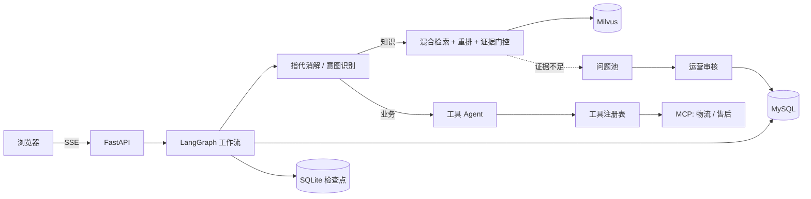

# PawHelp

宠物用品电商的智能客服：基于 FastAPI + LangGraph，覆盖知识问答（RAG）、订单与物流查询、退款与工单、多轮会话，以及一套把"答不上的问题"变成知识的运营闭环。

## 亮点

- **可中断、可恢复的对话工作流**：LangGraph 编排"指代消解 → 意图识别 → 确定性路由 → 检索或工具 Agent"。缺订单号时以中断弹出订单卡片，建工单前以中断等待用户确认；检查点落在 SQLite，服务重启后可以接着上次的中断继续。
- **混合检索与证据门控**：BGE-M3 稠密向量 + Milvus BM25 双路召回，RRF 融合后用 BGE 重排；回答前先过证据门控（离线校准的相关性阈值 + 模型充分性核查），证据不足就拒答并引用来源编号。
- **对模型输出不轻信**：改写后的问题若出现用户没说过的订单号，直接丢弃改写；用户明确给出的订单号不会被历史里的号码替换；写操作只能由前端确认触发，模型不能自行建单。
- **工具系统**：统一注册表负责 JSON Schema 校验、超时、只读重试、写操作确认和审计日志；物流与售后作为 MCP 服务接入，按白名单策略授权。
- **知识飞轮**：低置信度和用户反馈"未解决"的问题进入问题池，经模型标准化、查重后由运营审核，通过后写回知识库并重新向量化。
- **可观测与评测**：自托管 Langfuse 追踪；按意图统计 token 与估算成本；500 题检索评测集对比四种检索策略。

## 架构



## 检索评测

自建 500 题评测集（16 份知识文档；政策 100、型号 80、口语 100、多要点组合 100、故障码与耗材编号 30，另 90 题库外拒答）。其中 12 份文档和 200 题由 AI 生成、未经业务核准，构造方法和字面重合度见[评测集说明](evals/README.md)。可回答题 410 道，完整结果在 `reports/retrieval-evaluation.md`：

| 策略 | Recall@5 | MRR | 口语类 MRR | 多要点 Recall@5 |
|---|---:|---:|---:|---:|
| dense | 0.976 | 0.859 | 0.893 | 0.950 |
| bm25 | 0.978 | 0.837 | 0.809 | 0.947 |
| hybrid | 0.985 | 0.870 | 0.888 | 0.957 |
| hybrid + rerank | **0.993** | **0.894** | **0.950** | **0.992** |

生产链路（hybrid + rerank → 证据门控 → 生成）由大模型评审：

| Faithfulness | 答案要点覆盖 | 库外拒答正确率 | 可回答题误拒率 |
|---:|---:|---:|---:|
| 0.991 | 0.949 | 1.000（90/90） | 4.4%（18/410） |

BM25 在口语问法上排序最弱，在故障码、耗材编号上排序最好；混合检索补足召回，重排主要提升排序。证据门控偏保守：库外题全部原样拒答，代价是 18 道可回答题被误拒。其中 11 道是口语、极短问法或故障码对比，正确知识块多已排在首位，但重排分低于校准阈值；6 道通过粗筛后被证据核验判为不足，2 道判得对（所需时限表未召回、证据缺适用型号），4 道偏严（文档答案本身就是“另计”“以平台售后规则为准”，仍被要求给出具体数值）；1 道未召回正确知识块。阈值附近可回答题与库外题的分数交叠，放宽粗筛只会把更多库外题交给大模型核验。重排本来就用改写后的问法；若按线上改写和拆分的快照重新校准，阈值会从 0.127 升到 0.194，仅粗筛误拒就会从 11 道增至 20 道，因此保留现有阈值。另有 1 题因证据核验调用超时未评上。之后放宽了证据核验对“另计”“以平台规则为准”这类答案的要求：用存档证据重放 6 道核验误拒题和 8 道进入核验的库外题（各 3 次），误判从 8 次降到 3 次，库外题仍全部判为不足；上表为改动前的完整运行，全链路未重跑。

扩充语料后评测暴露了一个检索缺陷：查询理解让大模型猜测文档分类和内容类型，并把猜测当作 Milvus 硬过滤，猜成 FAQ 时会把手册和政策整类排除。去掉推断过滤后，同一套题的纯检索对比中 hybrid + rerank 的 Recall@5 从 0.938 升到 0.996，新题从 0.894 升到 0.994；查询改写由大模型生成，每次运行的分数有小幅波动，上表为最近一次完整运行。

意图识别另有 22 题标注集（每题 3 次），检查结构化字段与最终路由，见[评测集说明](evals/README.md)。

## 快速启动

需要 Python 3.12、[uv](https://docs.astral.sh/uv/) 和 Docker。

```powershell
uv sync --locked
Copy-Item .env.example .env    # 填写模型地址、模型名和密钥
docker compose up -d mysql etcd minio milvus
uv run alembic upgrade head
uv run python -m scripts.seed_db
uv run python -m scripts.ingest_knowledge
uv run python -m scripts.vectorize_knowledge
uv run uvicorn app.main:app --host 127.0.0.1 --port 8000
```

打开 <http://127.0.0.1:8000/> 聊天，<http://127.0.0.1:8000/admin> 进入后台。首次运行会下载 BGE 模型权重，有 NVIDIA GPU 时自动使用 CUDA。MCP 工具服务需另开终端启动，或在 `.env` 设置 `MCP_ENABLED=false`，详见[运行说明](docs/operations.md)。

| 页面 | 路径 | 用途 |
|---|---|---|
| 聊天 | `/` | 多会话、流式回答、订单卡片、引用来源与工具轨迹 |
| 知识库 | `/kb` | 文档同步、知识维护、向量化和检索调试 |
| RAG 评测 | `/rag-eval` | 四策略对比、证据覆盖、忠实度与人工复核 |
| 飞轮待审 | `/review` | 问题标准化、查重、审核与知识回写 |
| 观测与成本 | `/observability` | 按意图的 token、成本、校准阈值与评测趋势 |
| 主题分布 | `/topics` | 问题池的 17 类主题统计 |

## 测试

```powershell
uv run pytest
```

327 个测试，使用脚本化的假模型和内存检查点，不调用付费模型，也不读取本机 `.env`。其中 49 个 MySQL 集成测试需要设置 `TEST_DATABASE_URL`，指向一个已迁移到最新版本的一次性数据库，否则跳过。CI 运行离线测试和源码检查。

## 项目结构

```text
app/
  workflow/     对话工作流、意图分流、上下文记忆、工具 Agent
  knowledge/    切块、嵌入、混合检索、重排、证据门控、知识挖掘
  tools/        工具契约、注册与执行
  api/          HTTP 路由
  topics/       离线主题分类
mcp_servers/    物流、售后 MCP 服务
alembic/        数据库迁移
evals/          检索与意图评测集
tests/          回归测试
```

更多见[目录职责与数据流](docs/project-structure.md)。

## 离线主题分类器

旁路任务：用 RoBERTa-wwm-ext 全参微调的 17 类多标签模型，给问题池里的问题打主题标签，供运营统计，不参与实时对话。测试集 micro-F1 0.95，但测试数据主要是模型生成的模拟问法，不代表真实问题上的准确率。私人语料和权重不在仓库中，见[分类器说明](docs/topic-classifier.md)。

## 范围与限制

- 订单、退款、转人工均为演示数据和模拟服务，不连接真实交易或真人客服。
- 面向本机单实例部署：会话以匿名 UUID 区分，后台本机访问免令牌、远程需管理令牌，没有登录与权限体系，不应直接暴露到公网。

## 文档

[运行说明](docs/operations.md) · [业务数据接入](docs/data-integration.md) · [贡献指南](CONTRIBUTING.md) · [安全说明](SECURITY.md) · [第三方说明](THIRD_PARTY_NOTICES.md) · [MIT License](LICENSE)
