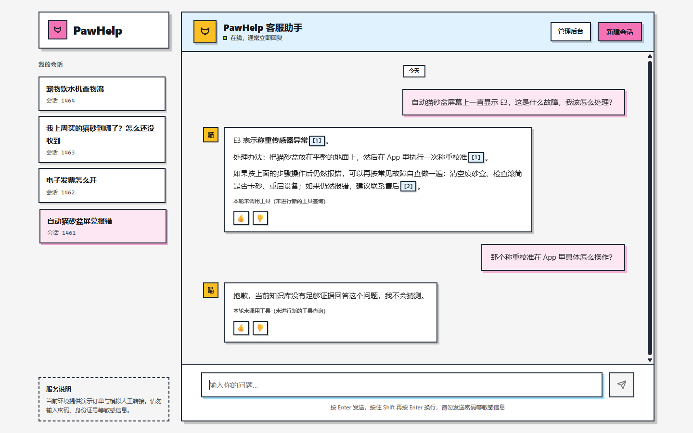
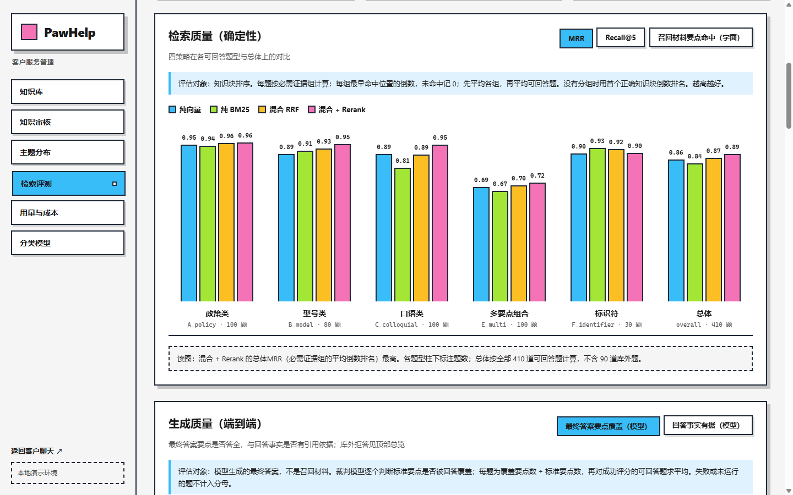
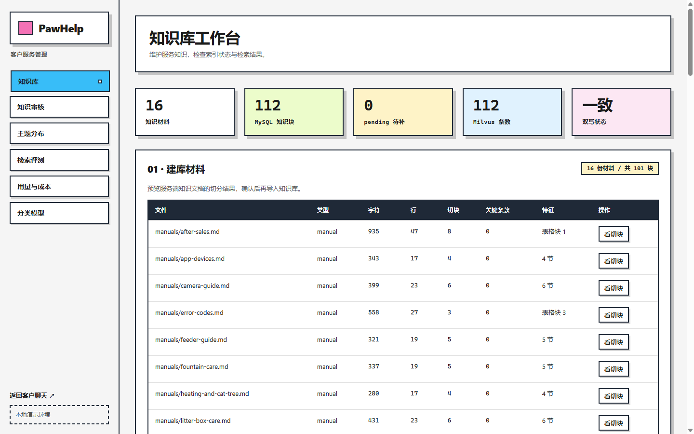
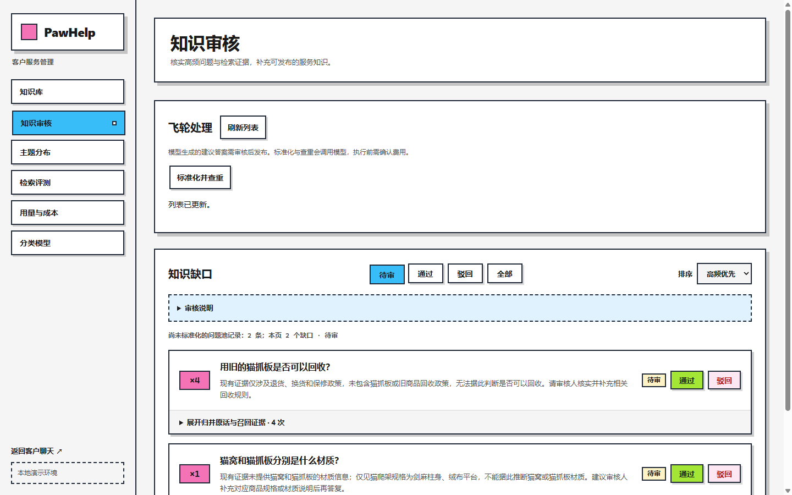
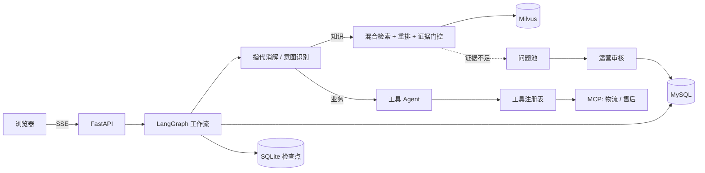

# PawHelp

宠物用品电商的智能客服：基于 FastAPI + LangGraph，覆盖知识问答（RAG）、订单与物流查询、退款与工单、多轮会话，以及一套把"答不上的问题"变成知识的运营闭环。

## 亮点

- **可中断、可恢复的对话工作流**：LangGraph 编排"指代消解 → 意图识别 → 确定性路由 → 检索或工具 Agent"。缺订单号时以中断弹出订单卡片，建工单前以中断等待用户确认；检查点落在 SQLite，服务重启后可以接着上次的中断继续。
- **混合检索与证据门控**：BGE-M3 稠密向量 + Milvus BM25 双路召回，RRF 融合后用 BGE 重排；回答前先过证据门控（离线校准的相关性阈值 + 模型充分性核查），证据不足就拒答并引用来源编号。充分性核查可选接入 TypeSafe Jev 决策模型（System One），按校准概率直接放行或拒答，拿不准的再交给大模型。
- **对模型输出不轻信**：改写后的问题若出现用户没说过的订单号，直接丢弃改写；用户明确给出的订单号不会被历史里的号码替换；写操作只能由前端确认触发，模型不能自行建单。
- **工具系统**：统一注册表负责 JSON Schema 校验、超时、只读重试、写操作确认和审计日志；物流与售后作为 MCP 服务接入，按白名单策略授权。
- **知识飞轮**：低置信度和用户反馈"未解决"的问题进入问题池，经模型标准化、查重后由运营审核，通过后写回知识库并重新向量化。人工录入、审核通过和会话挖掘的知识写入前，先由模型与最相近的已有知识比对，重复或与文档冲突的一律拒绝。
- **可观测与评测**：自托管 Langfuse 追踪；按意图统计 token 与估算成本；500 题检索评测集对比四种检索策略。

## 界面





| 知识库工作台 | 知识审核 |
|---|---|
|  |  |

## 架构



## 检索评测

自建 500 题评测集（16 份知识文档；政策 100、型号 80、口语 100、多要点组合 100、故障码与耗材编号 30，另 90 题库外拒答）。其中 12 份文档和 200 题由 AI 生成、未经业务核准，构造方法和字面重合度见[评测集说明](evals/README.md)。可回答题 410 道，分桶结果见 [`reports/retrieval-evaluation.md`](reports/retrieval-evaluation.md)：

| 策略 | Recall@5 | MRR | 口语类 MRR | 多要点 Recall@5 |
|---|---:|---:|---:|---:|
| dense | 0.980 | 0.859 | 0.903 | 0.947 |
| bm25 | 0.976 | 0.842 | 0.842 | 0.947 |
| hybrid | 0.983 | 0.866 | 0.905 | 0.952 |
| hybrid + rerank | **0.997** | **0.900** | **0.956** | **0.992** |

生产链路（hybrid + rerank → 证据门控 → 生成）由大模型评审，证据核验用 `EVIDENCE_JUDGE=jev`：

| Faithfulness | 答案要点覆盖 | 库外拒答正确率 | 可回答题误拒率 |
|---:|---:|---:|---:|
| 0.995 | 0.945 | 1.000（90/90） | 4.1%（17/410） |

- **混合补召回，重排提排序**：BM25 在口语问法上排序最弱（MRR 0.842），在故障码、耗材编号上最好；混合检索补足召回，重排把口语类 MRR 提到 0.956。
- **证据门控偏保守**：库外 90 题全部拒答，代价是 17 道可回答题被误拒（13 道重排分低于校准阈值，正确知识块都已召回或部分召回；4 道落在 Jev 的中间带，被大模型核验判为不足）。阈值按线上改写和拆分路径校准为 0.174，阈值附近两类题分数交叠，放宽只会让更多库外题进入模型核验。
- **评测找出过一个检索缺陷**：查询理解曾把大模型猜测的文档分类当作 Milvus 硬过滤，猜错时整类排除手册和政策；去掉推断过滤后，同一套题的纯检索对比中 hybrid + rerank 的 Recall@5 从 0.938 升到 0.996。

**Jev 证据判定（可选）**：同一份证据交给 TypeSafe Jev（`jev-1.14.0`）回答一个是/否概率问题，在 500 题存档上离线比较（498 题评上，1 题超时）。阈值只用训练题选：P ≤ 0.05 直接拒答、P ≥ 0.60 直接放行，中间交给大模型。全部题 AUC 0.998、Brier 0.048；线上路径的独立验证 77 题中 Jev 直接决定 93.5%，误拒、误放与大模型相同（均为 0）。这 77 题恰好没有库外题，所以另看全部 18 道验证库外题：Jev 给出的最高概率 0.42，低于放行阈值。2026-10-21 以 `jev` 模式跑完整 500 题：通过粗筛的 403 题中 Jev 直接决定 372 题（92.3%；放行 367，拒答 5，拒答的全是库外题），没有造成误拒或误放，大模型核验调用随之减少九成以上；与只用大模型的上一次运行相比，误拒 18 → 17、库外拒答 90/90 不变、Faithfulness 0.995 不变。剩下的偏严误拒都出在交给大模型的中间带，Jev 没有消除它们。默认仍用大模型（`EVIDENCE_JUDGE=llm`），设为 `shadow` 只把 Jev 概率写进日志，设为 `jev` 才由它分流；开启后问题与证据会发送到 TypeSafe。细节见[评测集说明](evals/README.md#jev-证据判定评测)。

查询改写由大模型生成，每次运行分数有小幅波动，上表为最近一次完整运行（2026-10-21）。误拒逐题分析、阈值重校准与核验放宽的重放结果见[评测集说明](evals/README.md#结果解读)。

意图识别另有 22 题标注集（每题 3 次），检查结构化字段与最终路由，见[评测集说明](evals/README.md)。

## 快速启动

需要 Python 3.12、[uv](https://docs.astral.sh/uv/) 和 Docker。

```powershell
uv sync --locked
Copy-Item .env.example .env    # 填写模型地址、模型名和密钥
docker compose up -d mysql etcd minio milvus
uv run alembic upgrade head
uv run python -m scripts.seed_db
uv run python -m scripts.ingest_knowledge
uv run python -m scripts.vectorize_knowledge
uv run --locked python -m scripts.start
```

`scripts.start` 一条命令启动容器、执行迁移，并拉起物流/售后 MCP 服务、主题分类器（有模型时）和主应用，就绪后打印地址；Ctrl+C 停止它启动的全部进程。打开 <http://127.0.0.1:8000/> 聊天，<http://127.0.0.1:8000/admin> 进入后台。首次运行会下载 BGE 模型权重，有 NVIDIA GPU 时自动使用 CUDA；应用启动后在后台预热检索模型，第一句提问不再等模型加载。分步启动见[运行说明](docs/operations.md)。

| 页面 | 路径 | 用途 |
|---|---|---|
| 聊天 | `/` | 多会话、流式回答、订单卡片、引用来源与工具轨迹 |
| 知识库 | `/kb` | 文档同步、知识维护、向量化和检索调试 |
| 知识审核 | `/review` | 问题标准化、查重、审核与知识回写 |
| 主题分布 | `/topics` | 问题池的 17 类主题统计 |
| 检索评测 | `/rag-eval` | 四策略对比、证据覆盖、忠实度与人工复核 |
| 用量与成本 | `/observability` | 按意图的 token、成本、校准阈值与评测趋势 |
| 分类模型 | `/acceptance` | 主题分类器的离线测试、阈值记录与错例复核 |

## 测试

```powershell
uv run pytest
```

360 个测试，使用脚本化的假模型和内存检查点，不调用付费模型，也不读取本机 `.env`。其中 49 个 MySQL 集成测试需要设置 `TEST_DATABASE_URL`，指向一个已迁移到最新版本的一次性数据库，否则跳过。CI 运行离线测试和源码检查。

## 项目结构

```text
app/
  workflow/     对话工作流、意图分流、上下文记忆、工具 Agent
  knowledge/    切块、嵌入、混合检索、重排、证据门控、知识挖掘
  tools/        工具契约、注册与执行
  api/          HTTP 路由
  topics/       离线主题分类
mcp_servers/    物流、售后 MCP 服务
alembic/        数据库迁移
evals/          检索与意图评测集
tests/          回归测试
```

更多见[目录职责与数据流](docs/project-structure.md)。

## 离线主题分类器

旁路任务：用 RoBERTa-wwm-ext 全参微调的 17 类多标签模型，给问题池里的问题打主题标签，供运营统计，不参与实时对话。目前还没有真实问题的标注集，所以暂不报告准确率。私人语料和权重不在仓库中，见[分类器说明](docs/topic-classifier.md)。

## 范围与限制

- 订单、退款、转人工均为演示数据和模拟服务，不连接真实交易或真人客服。
- 面向本机单实例部署：会话以匿名 UUID 区分，后台本机访问免令牌、远程需管理令牌，没有登录与权限体系，不应直接暴露到公网。

## 文档

[运行说明](docs/operations.md) · [业务数据接入](docs/data-integration.md) · [贡献指南](CONTRIBUTING.md) · [安全说明](SECURITY.md) · [第三方说明](THIRD_PARTY_NOTICES.md) · [MIT License](LICENSE)
